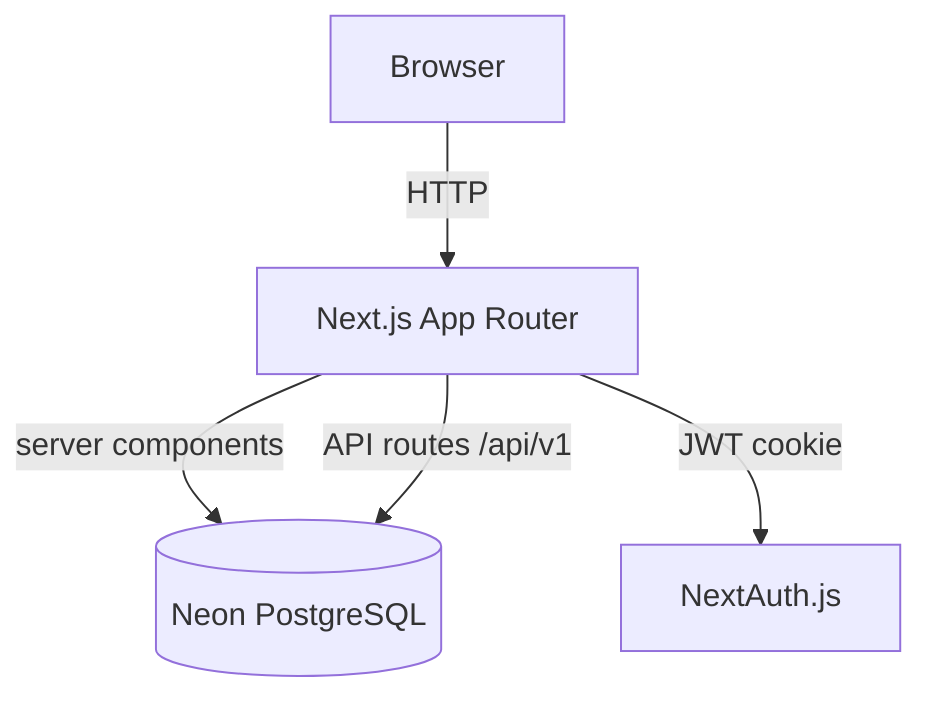
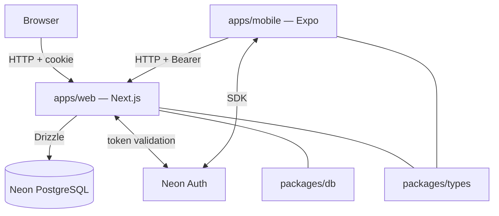

# Expense Tracker — Product Requirements Document 

## Problem

Managing personal finances across multiple accounts is fragmented. Users lack a single place to log transactions, track budgets, and understand their spending patterns — on both web and mobile.

## Target Users

Individuals managing personal finances who want full control over their data without depending on bank integrations. Comfortable with web apps (v1), mobile-first expected (v2).

## Goals

- Log income, expenses, and transfers across multiple accounts
- Categorize and label transactions for flexible analysis
- Set and monitor budgets by time period
- Visualize spending trends and account balances
- Import transactions from CSV/Excel files

## Non-Goals (v1 scope)

- Bank/Open Banking API sync (Plaid, etc.)
- Multi-user / shared household budgets
- Recurring transaction automation
- Push notifications
- Mobile app
- AI-powered features

## Feature List

| Feature | Description |
|---|---|
| Auth | Email + password registration and login |
| Transactions | CRUD for income / expense / transfer, with soft delete |
| Accounts | Multiple payment methods with auto-tracked balances |
| Categories | Hierarchical (parent → child), typed income/expense |
| Labels | Free-form color-coded tags for transactions |
| Budgets | Period-based budgets (one-time / weekly / monthly / yearly) |
| Dashboard | Financial overview, recent transactions, budget status |
| Reports | Spending charts by category and time |
| Import | CSV / Excel bulk import with downloadable template |
| Settings | Customizable number format, date format, currency symbol |
| Dark mode | Light / dark theme toggle |

## Architecture (v1)

## v2 Architecture

## v1 Tech Stack

| Layer | Choice |
|---|---|
| Framework | Next.js 15.5.7 App Router (TypeScript) |
| Database | PostgreSQL — Neon serverless |
| ORM | Drizzle ORM |
| Auth | NextAuth.js v4 — credentials + JWT (24h) |
| UI | shadcn/ui + Tailwind CSS |
| Forms | React Hook Form + Zod |
| Charts | Recharts |
| Tables | TanStack Table |
| Import | PapaParse (CSV) + SheetJS (Excel) |
| Hosting | Vercel |

## v2 Direction

### Architecture change
Turborepo monorepo with two apps sharing a common `@expense-tracker/db` package:
- `apps/web` — Next.js 16 (mirror of v1, fresh bootstrap)
- `apps/mobile` — Expo + Expo Router (full mirror of web)
- `packages/db` — Drizzle schema + migrations
- `packages/types` — shared TypeScript types

### Auth change
Replace NextAuth with **Neon Auth** for cross-platform compatibility.

### API
Keep `/api/v1` REST routes in the web app — consumed by both web and mobile.

### New features (v2 scope)
- **Budget suggestions (scope 1)** — rule-based: detect recurring transactions by pattern (merchant / category / amount over N months) and propose a budget
- **Budget suggestions (scope 2)** — AI-powered: send history to LLM for smarter inference
- **Forecast view** — monthly cash flow projection: expected income, expected expenses, projected remaining balance

### Process change
Figma design before any implementation. No AI-generated designs.
