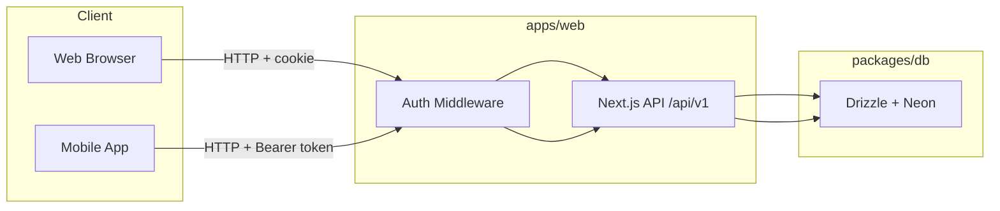
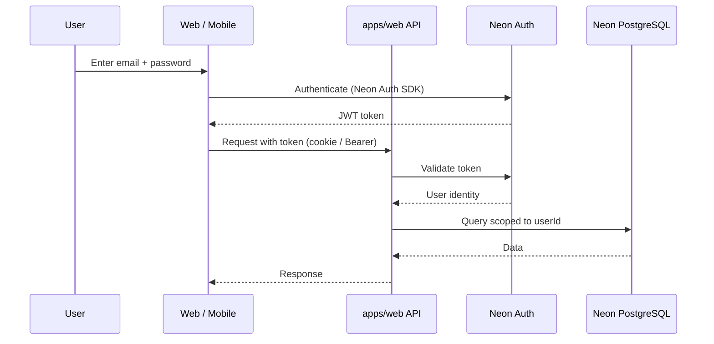

# Spec — v2 Monorepo Architecture

## Overview

v2 is a Turborepo monorepo housing a Next.js web app and an Expo mobile app. Shared packages prevent logic duplication across platforms.

**v2 starts on Next.js 16** (v1 was on 15.5.7). Do not carry over the v1 codebase — bootstrap fresh with `npx create-next-app@latest` at init time.

## Repository Structure

```
expense-tracker/
├── apps/
│   ├── web/                  # Next.js 15 App Router
│   └── mobile/               # Expo (Expo Router)
├── packages/
│   ├── db/                   # Drizzle schema, migrations, db client
│   └── types/                # Shared TypeScript types and Zod schemas
├── turbo.json
├── package.json              # Root workspace (pnpm)
└── .env                      # Shared env vars (Neon DB URL, etc.)
```

## Packages

### `@expense-tracker/db`
- Drizzle ORM schema (single source of truth)
- Migration files
- Neon serverless client setup
- Query helpers shared by web API routes
- **Not imported by mobile** — mobile calls the web API, never the DB directly

### `@expense-tracker/types`
- TypeScript interfaces for all domain entities (Transaction, Budget, Category…)
- Zod validation schemas reused in both web (API validation) and mobile (form validation)
- API response types: `ApiResponse<T>`, error shapes

## Apps

### `apps/web`
- Next.js 16, App Router, TypeScript
- Owns all `/api/v1/*` REST routes
- Uses `@expense-tracker/db` directly for data access
- Uses `@expense-tracker/types` for request/response typing
- Auth: Neon Auth (server-side token validation in middleware)

### `apps/mobile`
- Expo SDK, Expo Router (file-based routing — mirrors web route structure where possible)
- Calls `apps/web` API (`/api/v1/*`) — no direct DB access
- Uses `@expense-tracker/types` for API response typing and form validation
- Auth: Neon Auth mobile SDK (Bearer token, stored in SecureStore)
- Navigation: Expo Router (tab bar + stack)

## Data Flow



## Auth Flow



## Turborepo Pipeline

```json
{
  "pipeline": {
    "build": { "dependsOn": ["^build"], "outputs": [".next/**", "dist/**"] },
    "dev":   { "cache": false, "persistent": true },
    "lint":  {},
    "typecheck": { "dependsOn": ["^build"] }
  }
}
```

- `turbo dev` starts both `apps/web` (Next.js) and `apps/mobile` (Expo) in parallel
- `packages/db` builds first (depended on by `apps/web`)
- `packages/types` builds first (depended on by all)

## Environment Variables

| Variable | Used by | Purpose |
|---|---|---|
| `DATABASE_URL` | `packages/db` | Neon PostgreSQL connection string |
| `NEON_AUTH_SECRET` | `apps/web` | Token validation secret |
| `NEXT_PUBLIC_API_URL` | `apps/mobile` | Base URL of the web API |

- `.env` at root for shared vars; each app can have its own `.env.local`
- `vercel env pull` syncs Vercel environment to local `.env.local` for `apps/web`

## Key Constraints

- Mobile **never** imports from `packages/db` — only from `packages/types`
- All business logic lives in `apps/web` API routes (single source of truth)
- Schema changes: always in `packages/db`, run `drizzle-kit generate` + `migrate` from there
- Types shared via `packages/types` must be framework-agnostic (no Next.js or React Native imports)
