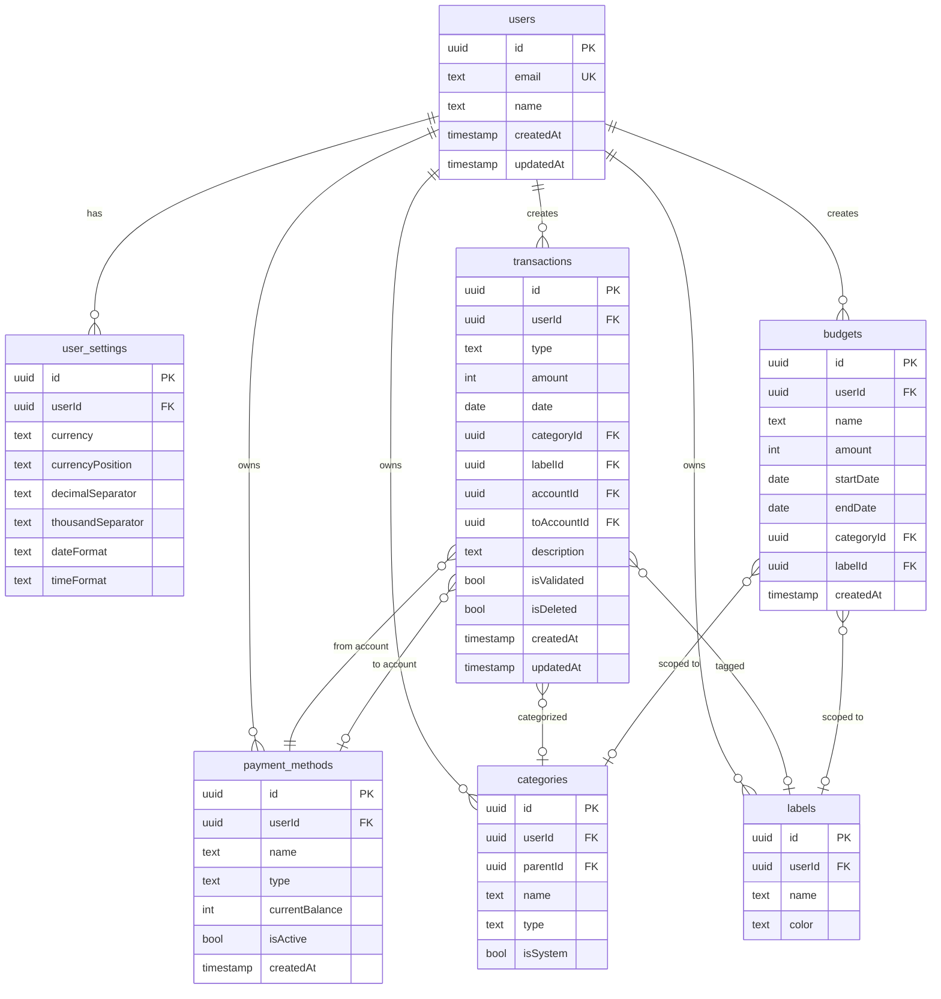

# Technical Specification

## Stack

| Layer | Choice | Notes |
|-------|--------|-------|
| Web framework | Next.js 16 — App Router | React 19, no `src/` dir |
| Mobile | Expo SDK + Expo Router | Ships after web (scope 2 for v2 launch) |
| Database | Neon PostgreSQL (serverless) | Already provisioned |
| ORM | Drizzle ORM | `packages/db` is the only DB entry point |
| Auth | Neon Auth | Replaces NextAuth — handles password hashing, JWT |
| UI | shadcn/ui + Tailwind v4 | `@theme` tokens, no inline styles |
| Charts | shadcn/ui Charts (Recharts) | Pre-themed, zero extra config |
| Forms | React Hook Form + Zod | Schemas from `packages/types` |
| Tables | TanStack Table v5 | Server-side pagination/filtering |
| State / fetching | TanStack Query v5 | Optimistic updates via `onMutate` |
| Import | PapaParse (CSV) + SheetJS (Excel) | Client-side parsing |
| Monorepo | Turborepo + pnpm workspaces | |
| Hosting | Vercel (web) | Neon DB branching per PR |

---

## Data Flow

```
Browser / Mobile
    │
    ▼
TanStack Query (cache + optimistic)
    │
    ▼
Next.js Route Handler  ──or──  Server Action
    │
    ▼
Service layer (framework-agnostic TS)
    │
    ▼
Drizzle ORM  ──  packages/db
    │
    ▼
Neon PostgreSQL
```

- Web mutations: prefer **Server Actions** (`useActionState`) for form submissions.
- Web queries: **Route Handlers** (`/api/v1/*`) consumed by TanStack Query.
- Mobile: calls `/api/v1/*` exclusively — never touches `packages/db` directly.

---

## Auth Strategy

**Provider**: Neon Auth

| Client | Token storage | Header |
|--------|--------------|--------|
| Web browser | HTTP-only cookie | Cookie |
| Mobile (Expo) | `SecureStore` | `Authorization: Bearer <token>` |

**Route protection**: `proxy.ts` at `apps/web/proxy.ts` — validates the Neon Auth JWT on every `/(dashboard)/*` request. Redirects unauthenticated users to `/login`.

**Password hashing**: delegated to Neon Auth (no manual bcrypt / argon2).

**Session**: JWT-only, no server-side session store. 24h expiry with auto-refresh.

---

## Error Contract

All errors in service and route layers throw or return an `AppError`.

```ts
// packages/types/src/errors.ts
export class AppError extends Error {
  constructor(
    public readonly code: ErrorCode,
    public readonly message: string,
    public readonly status: number,
  ) {
    super(message)
  }
}

export type ErrorCode =
  | 'VALIDATION_ERROR'      // 400 — Zod parse failure
  | 'UNAUTHORIZED'          // 401 — missing or invalid token
  | 'FORBIDDEN'             // 403 — valid token, wrong userId
  | 'NOT_FOUND'             // 404 — resource does not exist
  | 'CONFLICT'              // 409 — duplicate (e.g. email already exists)
  | 'UNPROCESSABLE'         // 422 — business rule violation
  | 'INTERNAL'              // 500 — unexpected server error
```

**API response envelope** (`packages/types/src/api.ts`):

```ts
export type ApiResponse<T> =
  | { success: true;  data: T }
  | { success: false; error: { code: ErrorCode; message: string } }
```

Route handlers catch `AppError` and map `error.status` to the HTTP status code. Unknown errors map to `INTERNAL` / 500.

---

## Schema Overview (7 tables)



**Key constraints:**
- `amount` is always stored in cents (integer). Never floats.
- `transactions.type = 'transfer'` → `toAccountId` required, `categoryId` null.
- `transactions.type = 'income' | 'expense'` → `categoryId` required, `toAccountId` null.
- All deletes on `transactions` are soft (`isDeleted = true`).
- `payment_methods.currentBalance` is updated programmatically by `TransactionService` inside a DB transaction — no SQL triggers.
- `budgets.categoryId` and `budgets.labelId` are both nullable (budget can be unscoped).

---

## Multi-Tenant Safety

Every query **must** be scoped by `userId`. Use the `withUserScope` Drizzle helper:

```ts
// packages/db/src/lib/scope.ts
export const withUserScope = (userId: string) => ({
  where: (table: { userId: Column }) => eq(table.userId, userId),
})
```

A service that omits `userId` scoping is a security bug — treat it as P0.

---

## Key Technical Decisions

| Decision | Choice | Reason |
|----------|--------|--------|
| Auth provider | Neon Auth | Cross-platform (web cookie + mobile Bearer) |
| Password hashing | Neon Auth (delegated) | No manual bcrypt/argon2 |
| Balance updates | `TransactionService` DB transaction | SQL triggers are hard to test and migrate |
| Chart library | shadcn/ui Charts | Already themed with Tailwind tokens |
| Multi-label | Single label per transaction (M:N deferred to scope 2) | Simpler schema for v2 launch |
| Recurring budgets | Explicit `startDate`/`endDate` only | Intentional regression from v1 |
| Route protection | `proxy.ts` (Next.js 16) | Renamed from `middleware.ts` in Next.js 16 |
| Amounts | Integer cents | Eliminates floating-point errors |
| Deletes | Soft delete only (`isDeleted`) | Preserves audit trail |
